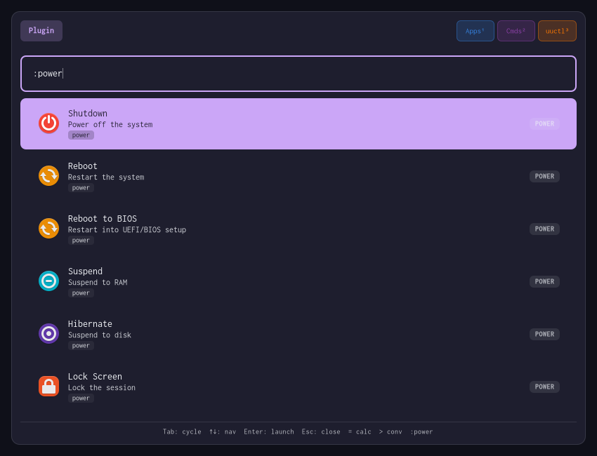

# Using Owlry

Owlry has one UI, one daemon, and a set of command-line tools. The UI is the
normal entry point; the rest are useful for diagnostics, scripts, and
integrations.



## Running the daemon

The daemon keeps providers warm. The UI can start it through systemd, or you
can run it directly.

### systemd user service (recommended)

```bash
systemctl --user enable --now owlry.service
```

Reload configuration from disk without restarting the daemon:

```bash
systemctl --user reload owlry.service
```

Refresh provider data without reloading the daemon:

```bash
owlry refresh          # all static providers
owlry refresh app      # one provider from `owlry providers`
```

### Socket activation

```bash
systemctl --user enable owlry.socket
```

The daemon starts the first time the UI connects. The packaged socket unit
sets `DirectoryMode=0700` and uses `owlry.service` as its service.

### Compositor autostart

```text
# Hyprland
exec-once = owlry -d

# Sway
exec owlry -d
```

Prefer one startup path. The 2.8 per-socket lock prevents a second daemon from
binding the same socket, but it is simpler to let systemd own the daemon.

## Command line

```text
owlry                          launch the UI in auto mode
owlry -m auto                  launch the UI in auto mode (explicit)
owlry -m <mode>                launch the UI in one provider mode
owlry --profile <name>         launch the UI with a named profile
owlry -p <text>                custom search prompt

owlry -d                       run the daemon (alias: owlry daemon)
owlry dmenu [-p <prompt>]      read stdin, print the selection
owlry selector [-p <prompt>]   selector protocol for rofimoji and similar tools
owlry doctor                   config, socket, provider, and stale-file diagnostics
owlry providers [<id>]         list providers or show one
owlry refresh [<id>]           refresh all static providers or one by id
owlry config validate          parse the active config
owlry config show              print the resolved effective config
owlry migrate-config [--force] TOML to owlry.lua; --force overwrites
```

Core modes are `app`, `cmd`, `dmenu`, and `auto`. Built-in provider modes are
`calc`, `conv`, and `power`. Optional modes are available when the matching
cargo feature is compiled in: `clip`, `emoji`, `rofimoji`, `ssh`,
`systemd`/`uuctl`, `web`, and `file`.

`owlry config validate` exits 1 on errors and 2 on warnings. `owlry config
show` prints the merged configuration as TOML.

Running the UI while a window is already open sends a toggle command. One
keybind can therefore open and close the launcher.

If the daemon is not running, the UI tries to start `owlry.service` through
the systemd user manager and retries the socket connection.

## dmenu mode

`owlry dmenu` reads newline-separated items from stdin and prints the selected
item to stdout. It runs locally and does not need the daemon.

```bash
# Screenshot menu
printf '%s\n' \
  "grimblast --notify copy screen" \
  "grimblast --notify copy area" \
  "grimblast --notify edit screen" \
  | owlry dmenu -p "Screenshot" \
  | sh

# Git branch checkout
git branch | owlry dmenu -p "checkout" | xargs git checkout

# Kill a process
ps -eo comm | sort -u | owlry dmenu -p "kill" | xargs pkill

# Open a project
find ~/projects -maxdepth 1 -type d | owlry dmenu | xargs code

# Package manager
pacman -Ssq | owlry dmenu -p "install" | xargs sudo pacman -S
```

The selected line is data, not a shell command. The examples pipe it into
`sh` or `xargs` themselves.

## Keyboard shortcuts

| Key | Action |
|---|---|
| `Enter` | Launch the selected item |
| `Right Arrow` | Open contextual actions for the selected item |
| `Shift+Enter` | Open a file with an application picker; in the picker, set the chosen app as default |
| `Escape` | Close the launcher or leave a submenu |
| `Up` / `Down` | Move through results |
| `Tab` | Cycle filter tabs |
| `Shift+Tab` | Cycle filter tabs in reverse |
| `Ctrl+1..9` | Toggle a tab by position |

## Search prefixes

| Prefix | Provider | Example |
|---|---|---|
| `:app` | Applications | `:app firefox` |
| `:cmd` | PATH commands | `:cmd git` |
| `:power` (`:sys`, `:system`) | Power and session actions | `:power shutdown` |
| `:calc` | Calculator | `:calc sqrt(16)` |
| `:conv` | Unit and currency converter | `:conv 5 ft to m` |
| `:clip` | Clipboard history | `:clip password` |
| `:emoji` | Emoji | `:emoji heart` |
| `:rofimoji` (`:chars`, `:kaomoji`) | Emoji and kaomoji picker | `:rofimoji` |
| `:ssh` | SSH hosts from `~/.ssh/config` | `:ssh server` |
| `:uuctl` (`:systemd`) | systemd user units | `:uuctl dbus` |
| `:web` | Web search | `:web rust docs` |
| `:file` | Filesystem search | `:file config` |
| `:recent` | Recently launched items, newest first | `:recent` |
| `:tag:X` | Filter all results by tag | `:tag:development` |

### Trigger prefixes

| Trigger | Provider | Example |
|---|---|---|
| `=` | Calculator | `= 5+3` |
| `>` | Converter | `> 20 km to mi` |
| `?` | Web search | `? rust programming` |
| `/` | File search | `/ .bashrc` |

## Direct commands and `:shell`

Typing `program args` launches that program with the arguments parsed as an
argument vector. No shell is involved.

```text
mpv VIDEO
printf hello
```

Shell syntax needs the explicit `:shell` prefix:

```text
:shell printf '%s\n' foo | wl-copy
:shell cd ~/projects && git status
```

Unquoted `;`, `&`, `|`, `$`, backticks, and redirections are rejected outside
`:shell`. `:cmd` remains a PATH-command filter; it does not enable shell
syntax.

## Profiles

Profiles are named sets of provider modes. Select one with
`owlry --profile <name>`.

Lua:

```lua
owlry.profiles {
  dev = { "app", "cmd", "ssh" },
  media = { "emoji", "clipboard" },
}
```

TOML:

```toml
[profiles.dev]
modes = ["app", "cmd", "ssh"]

[profiles.media]
modes = ["emoji", "clipboard"]
```

A profile can also set `show_all_tab = false` to keep Tab cycling inside its
configured tabs.

## Socket override

For a development daemon alongside a production one, set `OWLRY_SOCKET` to an
absolute path whose parent directory is private to you:

```bash
OWLRY_SOCKET="$XDG_RUNTIME_DIR/owlry-dev.sock" owlry -d &
OWLRY_SOCKET="$XDG_RUNTIME_DIR/owlry-dev.sock" owlry providers
```

See [Architecture](architecture.md) for the socket rules and the
`owlry.sock` lifecycle.
